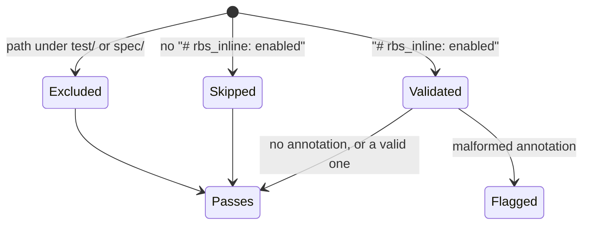
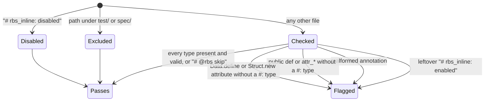
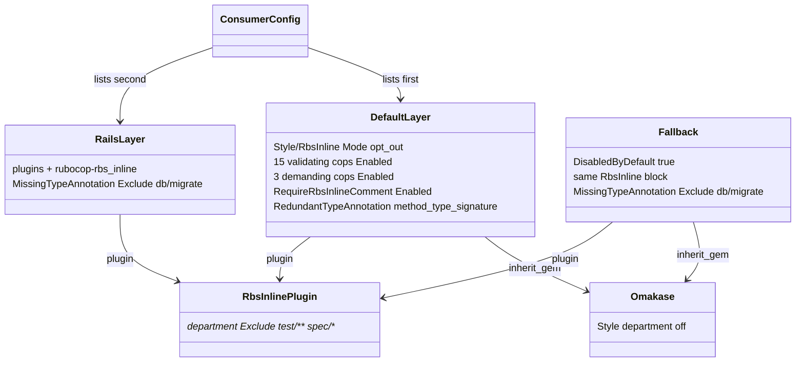

# Plan: Demand inline RBS signatures in every file of a personal project

From `intent.md` (2026-10-21). Status: accepted.

## Design

### Domain terms

- **Demanding cop** and **validating cop**: as defined in `GLOSSARY.md`. The demanding cops here are `MissingTypeAnnotation`, `MissingDataClassAnnotation` and `MissingStructClassAnnotation`.
- **Magic comment**: the `# rbs_inline: enabled` or `# rbs_inline: disabled` comment that `rubocop-rbs_inline` reads. Used as `intent.md` uses it. No new glossary entry.
- **Layer**: one file under `config/` (`default.yml`, `rails.yml`, `rspec.yml`, `capybara.yml`), as `CLAUDE.md` uses it.
- **Fallback**: the dotfiles file `rubocop/.rubocop.yml`, the source of `~/.rubocop.yml`. It lints a Ruby file that has no project config above it. It does not inherit this gem; it carries its own copy of the rules (`DisabledByDefault: true`).

### Diagrams

Before: how a file resolves today.



After: how a file resolves under `Mode: opt_out`.



The layers after the change. No layer inherits from another; a consumer lists each one.



### Signatures

The plugin excludes `test/**/*` and `spec/**/*`, so lint never demands these `#:` comments. They are design notation.

`SharedConfigurationTest` (`test/shared_configuration_test.rb`): proves the shared layers by linting Ruby sources through them and reading `--show-cops`.

```ruby
# Lints source as if it lived at path.
#: (String, ?String, ?path: String) -> [String, Process::Status]
def lint(source, configuration = "config/default.yml", path: "lib/example.rb")

# Returns the source after `--autocorrect-all`. `--stderr` moves the report off stdout.
#: (String, ?String, ?path: String) -> String
def autocorrect(source, configuration = "config/default.yml", path: "lib/example.rb")
```

`lint` gains the `path:` keyword; its existing callers do not change. `autocorrect` is new and private. It runs `--autocorrect-all` (`-A`), because `RedundantTypeAnnotation` is `SafeAutoCorrect: false` and plain `-a` leaves its offence in place (verified). `settings_for`, `run_rubocop`, `complaints_in`, `departments_offered_by` and `rspec_rules_switched_on_by` do not change.

`RubocopFallbackTest` (dotfiles `test/rubocop_fallback_test.rb`): proves the fallback by linting files in a temporary project.

```ruby
#: (String, *String, ?path: String) -> Hash[String, untyped]
def run_rbs_fixture(source, *options, path: RBS_FIXTURE_PATH)

# Copies the fallback into the temporary project as .rubocop.yml and lints with it there.
#: (String, String) -> Hash[String, untyped]
def run_with_project_fallback(path, source)
```

`RubySignaturesTest` (dotfiles `test/ruby_signatures_test.rb`): no helper change; one new test.

Not checked: rubocop-eirvandelden declined Steep and rbs_rails. It is a configuration gem with no library code.

### Complexity

- Each new gem test boots `bundle exec rubocop` once or twice, about 1–2 s each. The gem suite grows from about 23 to about 40 RuboCop runs.
- The dotfiles fallback suite grows by about 7 `rubocop` runs.
- A consuming project now runs the RbsInline cops on every non-test file instead of on almost none. The cost grows linearly with file count. One pass per file, as before.
- No database: no queries.

### Invariants

1. A file with no magic comment is checked by every RbsInline cop. Enforced by `Style/RbsInline: Mode: opt_out` in `config/default.yml` and in the fallback.
2. Every validating and demanding cop is on, though omakase switches the Style department off. Enforced by naming each one `Enabled: true` in `config/default.yml`.
3. Lint demands a `#:` signature on public methods and `attr_*` only. Enforced by `MissingTypeAnnotation` with `EnforcedStyle: method_type_signature` and `Visibility: public`.
4. Autocorrect never deletes a `#:` method signature. Enforced by `RedundantTypeAnnotation` with `EnforcedStyle: method_type_signature`. Safe `-a` does not touch the offence at all; `-A` keeps `#:` and removes the `# @rbs` lines.
5. `test/` and `spec/` stay outside every RbsInline cop in every stack. Enforced by the plugin's department `Exclude` (merged) and by `rails.yml` adding its `Exclude` at cop level only.
6. Only a Rails stack excludes migrations. Enforced by the gem's migration `Exclude` living in `rails.yml`, not `default.yml`.
7. Every layer loads on its own. Enforced by `rails.yml` listing `rubocop-rbs_inline` in its own `plugins:`.
8. No layer inherits from another. Unchanged; the existing guard covers it.

### Alternatives

1. **Smallest diff** (adopted as the base): every edit goes into the file that already holds that concern, in its idiom. `rails.yml` gains the plugin and one `Exclude`. Tests change in place.
2. **Behaviour-first proof** (adopted in part): every criterion proven by linting a fixture through the real stack, including a single "every validating rule broken" fixture in place of the `--show-cops` test. Adopted: the behaviour tests per criterion, the new `rails_project.yml` fixture, the invariant tests for migrations under `default.yml` and for tests under the Rails stack, and the autocorrect-keeps-`#:` test. Rejected: the broken-rules fixture. One offence can mask another, and the existing `--show-cops` test guards omakase reverting a cop more cheaply.
3. **Fallback inherits the gem** (rejected): `rubocop/.rubocop.yml` would `inherit_gem: rubocop-eirvandelden: config/default.yml` and drop its copy, removing the drift between the two files. Rejected: it changes everything else the fallback does (it sets `DisabledByDefault: true` and loads `rubocop-capybara`), and it needs the gem installed for the global Ruby on every machine and in dotfiles CI. That is a larger change than `intent.md` asks for.

## Design decisions

- `RedundantTypeAnnotation` gets `EnforcedStyle: method_type_signature` in the gem and the fallback. `intent.md` does not name this setting. Its default (`doc_style`) makes autocorrect delete a `#:` signature when `# @rbs` lines sit beside it, which contradicts the decision "Methods use `#:` signatures only". Verified with rubocop-rbs_inline 2.0.0: with the setting, autocorrect keeps `#:` and removes the `# @rbs` lines.
- `RequireRbsInlineComment` drops `AllowMissingComment: true`. `opt_out` mode ignores that setting, so keeping it would mislead a reader. The cop stays `Enabled: true`, as `intent.md` decides.
- `rails.yml` adds `rubocop-rbs_inline` to `plugins:`. Without it, `rails.yml` loaded on its own (as `test_rails_projects_get_the_rails_advice` does) fails with "unrecognized cop or department Style/RbsInline/MissingTypeAnnotation". Verified.
- `CHANGELOG.md`: `## Unreleased` becomes `## 1.0.0`. Its first bullet (opt-in checks) is no longer true and is rewritten as the breaking change.
- `Visibility: public` also skips `protected` methods. `intent.md` asks for public methods only, so this matches.
- The Rails acceptance test uses a new fixture `test/fixtures/rails_project.yml` (default plus rails), because the criterion names exactly those two layers and no fixture has exactly them.
- The fallback test for the migration exclusion copies the fallback into the temporary project as `.rubocop.yml`. Verified: RuboCop resolves `'**/db/migrate/**/*'` in a file named `.rubocop.yml` against that file's directory, so the fallback passed with `-c` from the dotfiles checkout never excludes a migration in a temporary project. `~/.rubocop.yml` sits above the files it lints, so the copy reproduces real use.
- The dotfiles part is delivered on its own branch `rbs-inline-cop-opt-out` in its own worktree of `~/Developer/dotfiles`, created with `worktree-create`, and its own pull request. `intent.md`'s Constraints approve this.
- `rubocop-rbs_inline` gets the constraint `~> 2.0` in the gemspec, in the `dependencies` skill's major.minor style. The config names cops that exist only since 1.7.0 (Struct cops) and a `Mode` that exists only since 1.8.0, and RuboCop refuses to load a config that names an unknown cop. With the constraint, `bundle update rubocop-eirvandelden` also lifts an older locked plugin. The locked version is already 2.0.0. This changes a constraint; it adds and removes no dependency.
- Tension with `intent.md`'s `## Decisions`: "Work files should not use RBS inline" against "Change the dotfiles fallback". The fallback lints any repository without its own `.rubocop.yml`, a work repository included. `intent.md` puts work projects out of scope and asks for the fallback change, so the plan follows it, and the report raises it as a `Decision needed` line. No other conflict was found.

## Integration points

- `rubocop-rbs_inline` 2.0.0 (locked). `Mode` exists since 1.8.0; the Struct cops since 1.7.0; `Visibility` since 1.5.0. The gemspec constraint becomes `~> 2.0`.
- `rubocop-rails-omakase`: switches the Style department off, which is why every RbsInline cop is named.
- Consuming projects: they pick the change up on `bundle update rubocop-eirvandelden` and then fail lint until annotated.
- The dotfiles repository: `rubocop/.rubocop.yml` (linked to `~/.rubocop.yml` by stow, already linked; no `stow` run), `agents/.agents/skills/ruby-style/SKILL.md`, and the dotfiles lefthook `rubocop` jobs, which lint dotfiles' own changed `.rb` files through the fallback.

## Files that change

Gem repository (`rubocop-eirvandelden`, branch `rbs-inline-cop-opt-out`):

- `config/default.yml` — the RbsInline block: `Mode: opt_out`; add `Enabled: true` for `DataClassCommentAlignment`, `DataDefineWithBlock`, `MissingDataClassAnnotation`, `MissingStructClassAnnotation`, `RedundantInstanceVariableAnnotation`, `StructClassCommentAlignment`, `StructNewWithBlock`; add `MissingTypeAnnotation` with `Enabled: true`, `EnforcedStyle: method_type_signature`, `Visibility: public`; add `EnforcedStyle: method_type_signature` to `RedundantTypeAnnotation`; drop `AllowMissingComment` from `RequireRbsInlineComment`. Keep the cops in alphabetical order. Rewrite both comments: every file is checked, `# rbs_inline: disabled` is the only way out, a leftover `# rbs_inline: enabled` is flagged and autocorrect removes it, omakase is why each cop is named.
- `config/rails.yml` — add `rubocop-rbs_inline` to `plugins:`; add `Style/RbsInline/MissingTypeAnnotation: Exclude: ['**/db/migrate/**/*']` beside the two existing migration excludes, with a one-line comment: migrations are generated, run once and never called from code.
- `rubocop-eirvandelden.gemspec` — `spec.version = "1.0.0"`; `spec.add_dependency "rubocop-rbs_inline", "~> 2.0"`.
- `Gemfile.lock` — `rubocop-eirvandelden (1.0.0)` and its `rubocop-rbs_inline (~> 2.0)` line, written by Bundler (`bi`), never by hand.
- `CHANGELOG.md` — `## Unreleased` becomes `## 1.0.0`; first bullet rewritten: breaking, every non-test file is checked, public methods and `attr_*` need a `#:` signature, `Data.define` and `Struct.new` attributes need a `#:` type. New bullet: `# rbs_inline: disabled` is the only way out, and a leftover `# rbs_inline: enabled` is flagged and removed by autocorrect. Migrations are exempt in Rails projects.
- `README.md` — rewrite the inline RBS paragraph (line 35) to match the CHANGELOG.
- `test/fixtures/rails_project.yml` — new: inherits `../../config/default.yml` and `../../config/rails.yml`.
- `test/shared_configuration_test.rb` — the tests in `## Proof`. Remove `MALFORMED_OPTED_IN`, `VALID_OPTED_IN`, `NOT_OPTED_IN` and their three tests, and `test_the_shared_rules_never_demand_the_rbs_inline_magic_comment`; their behaviour is reversed. `WRONG_YARD_TAG_TYPE` gains `#: (Array[String]) -> Array[String]` between the YARD line and the `def`, or it fails on `MissingTypeAnnotation`. `VALIDATING_RBS_RULES` becomes `INLINE_RBS_RULES` and gains the 5 validating and 3 demanding cops plus `RequireRbsInlineComment`.

Dotfiles repository (`~/Developer/dotfiles`, branch `rbs-inline-cop-opt-out`):

- `rubocop/.rubocop.yml` — the rbs_inline block: add `RequireRbsInlineComment`, the 7 cops listed for `default.yml` and `MissingTypeAnnotation`, each `Enabled: true` (`DisabledByDefault: true` means each must be named); `MissingTypeAnnotation` gets the same `EnforcedStyle` and `Visibility` plus `Exclude: ['**/db/migrate/**/*']`; `RedundantTypeAnnotation` gets `EnforcedStyle: method_type_signature`. Rewrite the comment that says the demanding cops stay off.
- `agents/.agents/skills/ruby-style/SKILL.md` — line 49: "inline RBS signatures (`#:` or `# @rbs`, RBS 4 syntax) on methods" becomes a `#:` method type signature in RBS 4 syntax, such as `#: (String) -> String`, directly above each public method. The line keeps the words "Personal" and "inline RBS", which `test_ruby_style_personal_rule_names_inline_rbs` matches.
- `test/rubocop_fallback_test.rb` — `VALID_RBS_FIXTURE#title` swaps its two `# @rbs` lines for `#: (Integer) -> String`, or it fails on `MissingTypeAnnotation`. New tests in `## Proof`.
- `test/ruby_signatures_test.rb` — one new test in `## Proof`.

## Order of work

Gem repository, in this worktree:

1. Write `test_a_public_method_without_a_signature_fails_lint` (acceptance criterion 2), run `bundle exec ruby -Itest test/shared_configuration_test.rb -n test_a_public_method_without_a_signature_fails_lint`, watch it fail (no offence: opt-in mode).
2. Write the remaining gem tests from `## Proof`, the `path:` keyword on `lint`, the `autocorrect` helper and `test/fixtures/rails_project.yml`. Remove the four reversed tests and their constants. Run them; each new demanding or opt-out test fails.
3. Edit `config/default.yml`. Run the file; every new test passes except the Rails tests and the version test.
4. Edit `config/rails.yml`. Run the file; the Rails tests pass, and `test_rails_projects_get_the_rails_advice` still passes.
5. Fix `WRONG_YARD_TAG_TYPE` and extend `INLINE_RBS_RULES`. Run the file.
6. Bump the gemspec to `1.0.0` and constrain `rubocop-rbs_inline` to `~> 2.0`, run `bi` to refresh `Gemfile.lock`. Run the version and constraint tests.
7. Rewrite `CHANGELOG.md` and the README paragraph.
8. Run `bundle exec rake test` and `bundle exec rubocop`. Both green.
9. Re-read the diff; commit in small steps (tests plus config; version; docs).

Dotfiles repository, in a new worktree `~/Developer/dotfiles/.worktrees/rbs-inline-cop-opt-out` made with `worktree-create`:

10. Write `test_fallback_reports_public_method_without_signature`, run `ruby test/rubocop_fallback_test.rb -n test_fallback_reports_public_method_without_signature`, watch it fail.
11. Write the remaining fallback tests, the `path:` keyword and `run_with_project_fallback`. Change `VALID_RBS_FIXTURE#title`. Run them; the new ones fail.
12. Edit `rubocop/.rubocop.yml`. Run `ruby test/rubocop_fallback_test.rb`; green.
13. Write `test_ruby_style_asks_for_a_colon_signature_above_each_method`, run it, watch it fail. Edit `ruby-style/SKILL.md` line 49. Run `ruby test/ruby_signatures_test.rb` and `ruby test/rbs_inline_tooling_test.rb`; green.
14. Run the full dotfiles suite (`bin/test`). Re-read the diff; commit.

## Risks

- Every consuming project fails lint after `bundle update rubocop-eirvandelden` until its public methods are annotated. `intent.md` accepts this; the 1.0.0 bump and the CHANGELOG announce it.
- The fallback also lints the dotfiles repository's own Ruby, which has no `.rubocop.yml`. Measured: 373 `MissingTypeAnnotation` offences in 32 non-test `.rb` files. Lefthook lints changed files only, so this pull request (YAML, Markdown, tests) passes, but the next edit to any of those 32 files fails pre-commit until it is annotated. Dotfiles CI does not run RuboCop. See the `Decision needed` in the report.
- Any repository without its own `.rubocop.yml`, a work repository included, is linted by the fallback and now gets RBS demands. `intent.md` puts work projects out of scope; a work repository normally carries its own config, which stops the walk up to `~`.
- Two hand-kept copies (gem and fallback) can drift. Mirrored behaviour tests in both repositories reduce it; no test compares the files. Alternative 3 was rejected for scope.
- Clean fixtures must also satisfy every omakase Layout cop, so an omakase release can break an RbsInline test for an unrelated reason. Each assertion passes the full report as its message, so the cause is visible.
- A consumer locked on a `rubocop-rbs_inline` older than 1.7.0 could not load the new cop names. The `~> 2.0` constraint makes Bundler lift it on `bundle update rubocop-eirvandelden`. A future plugin 3.0 needs a deliberate constraint bump.
- Rejected: the broken-rules fixture (see Alternatives); keeping `AllowMissingComment: true` (misleading under `opt_out`).

Out of scope: work projects; annotating any consuming project or the dotfiles' own Ruby; `UntypedInstanceVariable`; Steep, `rbs validate`, `sig/`; YARD, RSpec and Capybara settings; the `rails-architecture` and `plan` skills, which still offer `# @rbs` as a method signature; the README's "Loose Ruby files" section, which wrongly says `~/.rubocop.yml` inherits this gem.

## Proof

Gem, `test/shared_configuration_test.rb` unless named otherwise:

- A file with no magic comment and `# @rbs name: Array[String` fails lint under `default.yml` → `test_a_malformed_inline_rbs_annotation_fails_lint_without_a_magic_comment` (asserts `Style/RbsInline/InvalidTypes` in the output)
- A public `def greet(name)` with no annotation fails → `test_a_public_method_without_a_signature_fails_lint` (asserts `Style/RbsInline/MissingTypeAnnotation`)
- With `#: (String) -> String` directly above it, it passes → `test_a_public_method_with_a_signature_above_it_passes_lint`
- A private method with no annotation passes → `test_a_private_method_without_a_signature_passes_lint`
- `attr_reader :name` fails without a trailing `#: String` → `test_a_public_attribute_without_a_type_fails_lint`
- `attr_reader :name #: String` passes → `test_a_public_attribute_with_a_trailing_type_passes_lint`
- `Point = Data.define(:x, :y)` fails until each attribute has a `#:` type → `test_a_data_class_fails_lint_until_each_attribute_has_a_type` (asserts `MissingDataClassAnnotation` untyped; clean with one attribute per line and aligned `#: Integer`)
- `Struct.new` behaves the same → `test_a_struct_class_fails_lint_until_each_attribute_has_a_type`
- A file that starts with `# rbs_inline: disabled` passes, however annotated → `test_a_file_that_opts_out_passes_lint_however_it_is_annotated` (malformed annotation plus an unannotated public method)
- A file with `# rbs_inline: enabled` fails with "Remove `# rbs_inline:` magic comment." → `test_a_leftover_rbs_inline_magic_comment_fails_lint`
- Autocorrect removes it → `test_autocorrect_removes_a_leftover_rbs_inline_magic_comment` (corrected source has no `# rbs_inline:` and still has the signed `def`)
- A method marked `# @rbs skip` passes without a signature → `test_a_method_marked_rbs_skip_passes_lint_without_a_signature`
- An unannotated public method in `test/` or `spec/` passes → `test_an_unannotated_public_method_in_a_test_or_spec_passes_lint` (`path: "test/greeter_test.rb"` and `path: "spec/greeter_spec.rb"`)
- Under `default.yml` and `rails.yml`, a migration's `def change` passes → `test_a_rails_project_does_not_demand_a_signature_on_a_migration` (`test/fixtures/rails_project.yml`, `path: "db/migrate/20260101000000_create_greetings.rb"`)
- A controller's public action without a signature fails → `test_a_rails_project_demands_a_signature_on_a_controller_action` (`path: "app/controllers/greetings_controller.rb"`)
- The gem reports version `1.0.0` → `test_the_gem_reports_version_one`
- Invariant: the plugin knows every cop the config names, enforced by the gemspec constraint → `test_the_gem_asks_for_an_rbs_inline_plugin_that_knows_every_named_cop` (asserts the requirement `~> 2.0`)
- The CHANGELOG states the break and the `# rbs_inline: disabled` escape → check: `sed -n '/^## 1.0.0/,/^## 0.1.0/p' CHANGELOG.md | grep -e 'rbs_inline: disabled' -e '[Bb]reak'` prints both lines
- A loose Ruby file linted by the fallback fails on an unannotated public method → dotfiles `test/rubocop_fallback_test.rb` `test_fallback_reports_public_method_without_signature`
- …and passes once annotated → dotfiles `test/rubocop_fallback_test.rb` `test_fallback_accepts_valid_rbs_inline_signature` (fixture changed to `#:` only)
- The `ruby-style` skill tells an agent to write `#: (String) -> String` above a personal method, and no longer offers `# @rbs` lines as a method signature → dotfiles `test/ruby_signatures_test.rb` `test_ruby_style_asks_for_a_colon_signature_above_each_method` (documentation section includes "`#: (String) -> String`" and has no `# @rbs`)
- The gem's test suite and its own RuboCop run are green → check: `bundle exec rake test && bundle exec rubocop`
- Invariant: every validating and demanding cop is on, enforced by `config/default.yml` → `test_the_shared_rules_switch_on_every_inline_rbs_rule` (over `INLINE_RBS_RULES`)
- Invariant: autocorrect never deletes a `#:` signature, enforced by `RedundantTypeAnnotation` in `config/default.yml` → `test_autocorrect_keeps_a_colon_signature_and_drops_rbs_lines_beside_it` (through `autocorrect`, which runs `-A`; asserts the corrected source equals the signed method alone)
- Invariant: only a Rails stack excludes migrations, enforced by `config/rails.yml` → `test_the_shared_rules_demand_a_signature_on_a_migration_outside_rails`
- Invariant: tests stay excluded in the Rails stack, enforced by the plugin department `Exclude` → `test_a_rails_project_does_not_demand_a_signature_in_a_test`
- Invariant: `rails.yml` loads on its own, enforced by its `plugins:` → `test_rails_projects_get_the_rails_advice` (existing, unchanged)
- Query count: Not affected; no database.

Per changed file, the unit tests expected, named as behaviour:

- `config/default.yml`, `config/rails.yml`, gemspec: configuration, proven by the tests above. No unit tests of their own.
- `test/shared_configuration_test.rb`: `lint` with `path:` and `autocorrect` are private helpers; no tests of their own.
- dotfiles `rubocop/.rubocop.yml`, beyond the two criteria lines: `test_fallback_accepts_an_unannotated_private_method`, `test_fallback_reports_untyped_data_and_struct_attributes`, `test_fallback_reports_a_leftover_rbs_inline_magic_comment`, `test_fallback_skips_a_file_that_opts_out`, `test_fallback_does_not_demand_a_signature_on_a_migration` (through `run_with_project_fallback`), and the existing `test_fallback_autocorrect_keeps_valid_rbs_inline_signature`.
- dotfiles `ruby-style/SKILL.md`: the one test above; the existing `test_ruby_style_personal_rule_names_inline_rbs` stays green.

Test setup: gem tests pipe heredoc constants through `bundle exec rubocop --stdin <path>`; the new fixture config `test/fixtures/rails_project.yml` stacks default and rails. Dotfiles tests write files into a `Dir.mktmpdir` project and run the global `rubocop`; the migration test copies the fallback into that project as `.rubocop.yml`. Dotfiles fixtures avoid endless methods (CI parses as Ruby 2.7). No network, no database.

---
Domain skills applied: software-design, glossary, diagrams, ruby-style, dependencies (no dependency added or removed).

## Critique

### Round 1 (codex exec -p terra)

- The plan leaves `rubocop-rbs_inline` unpinned although the config names cops from 1.7.0 and a `Mode` from 1.8.0 → fixed (gemspec constraint `~> 2.0` added to Design decisions, Files that change, Order of work, Risks and Proof)
- `RedundantTypeAnnotation` is `SafeAutoCorrect: false`, so a safe `-a` run cannot prove that `#:` stays and `# @rbs` goes → fixed (the `autocorrect` helper runs `--autocorrect-all`, verified that `-a` leaves the offence, Invariant 4 and its Proof line say so)
- The fallback demands signatures in a work repository without its own config, which conflicts with the decision that work files do not use inline RBS → fixed (Design decisions names the tension instead of claiming no conflict; the report raises it as a Decision needed line)
  - The plan keeps the fallback change, because `intent.md` asks for it and puts work projects out of scope.
- The README's "Loose Ruby files" section wrongly says `~/.rubocop.yml` inherits the gem and should be corrected while the README is open → dismissed: orthogonal to this change; playbook rule 21 sends it to its own pull request, and the report proposes it as a follow-up
