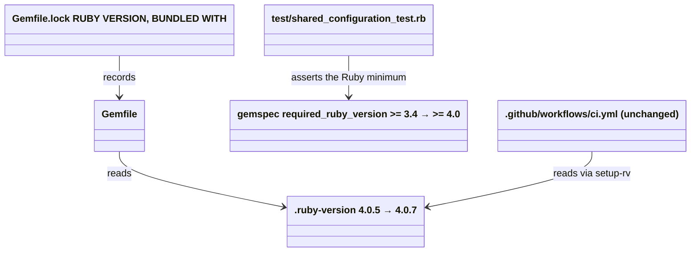

# Plan: Update all dependencies, including Ruby

From `intent.md` (2026-10-21). Status: accepted.

## Design

### Domain terms

- **Development Ruby**: the version in `.ruby-version`. The `Gemfile` (`ruby file: ".ruby-version"`), the `RUBY VERSION` section of `Gemfile.lock` and CI (`spinel-coop/setup-rv` with `ruby-version: current`) all read it.
- **Ruby minimum**: the gemspec's `required_ruby_version`. It is the gem's contract with consumers. RuboCop also infers this repository's `TargetRubyVersion` from it, because no `.rubocop.yml` here sets one.
- **Consumer**, **layer**: as in `AGENTS.md` (`CLAUDE.md` is a symlink to it). No `GLOSSARY.md` exists in this repository.

### Diagrams



### Signatures

Not affected: the gem ships YAML only and has no Ruby classes. One existing test changes its expected value and its comment.

Not checked: this repository declined Steep and rbs_rails; it has no Ruby code to type.

### Complexity

Not affected: no runtime path is added or changed.

### Invariants

- The development Ruby satisfies the Ruby minimum. Bundler enforces it: it refuses to resolve the path gem `rubocop-eirvandelden` under a Ruby below its `required_ruby_version`.
- The lockfile's `RUBY VERSION` equals `.ruby-version`. Bundler enforces it through `ruby file:`.
- The Ruby minimum is exactly `>= 4.0`. `test_the_gem_asks_for_a_ruby_its_projects_actually_run` enforces it.

### Alternatives

1. **Minimal diff (chosen).** Bump the files, update the one existing test's expected value and rewrite its comment, which today argues against a newer minimum. No new test.
2. **Strongest proof.** Also replace the equality assertion with `satisfied_by?` checks for 3.4.11 and 4.0.0, and add a test that `.ruby-version` satisfies the Ruby minimum. Rejected: Bundler already refuses a development Ruby below the minimum, so the new test asserts a fact twice. The 3.4/4.0 install behaviour is proved once by a manual check instead. The playbook says configuration has no tests.
3. **Pin `spinel-coop/setup-rv` to its only tag, `v1`.** Rejected: `v1` is 32 commits behind `main`, so it is a downgrade, and CI depends on the `current` and `install-gems` inputs.

## Design decisions

- `actions/checkout@v7.0.1` is already the latest release (2026-07-20). `spinel-coop/setup-rv@main` is a branch, not a pinned release, and its only tag `v1` is older than `main`. So `ci.yml` gets no edit. The approval to edit it goes unused.
- `prism` 2.0.0 cannot be reached. `rubocop-ast` 1.50.0 (`prism ~> 1.7`) and `minitest` 6.0.6 (`prism ~> 1.5`) cap it below 2.0, and both are at their latest release. Forcing it needs a new direct dependency, which intent forbids. Plain `bundle outdated` will therefore still list `prism`, so the criterion "`bundle outdated` lists nothing" cannot hold as written. This plan proves it with `bundle outdated --strict`, which lists only versions the dependency graph allows. This changes how an agreed criterion is read: it is a decision the coordinator must confirm with Etienne before delivery. If he refuses, the change blocks until `rubocop-ast` and `minitest` allow prism 2.
- Bundler moves from 4.0.19 to 4.0.23, the latest release. Ruby 4.0.7 ships 4.0.23 as its default gem (`ruby-4.0.7/lib/ruby/gems/4.0.0/specifications/default/bundler-4.0.23.gemspec`), so nothing is installed. Intent says "every gem to its latest version"; Bundler is in the lockfile as `BUNDLED WITH`.
- Every Ruby, Bundler, test and lint command runs through `rv run --` from the worktree root. A shell that started before `.ruby-version` changed keeps the old Ruby's `GEM_HOME`. `rv run --` reads `.ruby-version` on each call. Checked during planning: in a scratch copy with `.ruby-version` 4.0.7, `rv run -- ruby -v` prints 4.0.7 and `rv run -- bundle -v` prints 4.0.23.
- `BUNDLER_VERSION=4.0.23` is set for the lockfile update. Ruby 4.0.7's gem directory also holds `bundler` 4.1.0.beta1, which a bare `bundle` can pick up; the variable stops the lockfile recording a beta.
- The test name `test_the_gem_asks_for_a_ruby_its_projects_actually_run` stays. Only its expected value and its comment change.
- No README change: the README names no Ruby minimum.
- No glossary write in this stage: the hand-over limits this stage to `plan.md`. The terms above can go into a new `GLOSSARY.md` later.

## Integration points

- Consumers: after their next `bundle update rubocop-eirvandelden`, a consumer on Ruby below 4.0 cannot install the gem.
- CI: setup-rv reads `.ruby-version`, so CI installs Ruby 4.0.7, and Bundler 4.0.23 from the lockfile. The `ubuntu-slim` runner must download Ruby 4.0.7 through rv.
- gem.coop: the Gemfile source. All version data above comes from it.

## Files that change

- `.ruby-version` — `4.0.5` to `4.0.7`.
- `Gemfile.lock` — `rubocop-capybara` 3.0.0 to 3.1.0 (its `rubocop` requirement moves to `~> 1.89`), `uri` 1.1.1 to 1.1.2, their two checksums, `rubocop` 1.92.0 to 1.92.1 and its checksum (released after this plan, bumped in its own commit), `RUBY VERSION` to `ruby 4.0.7`, `BUNDLED WITH` to `4.0.23`. Checked during planning: a scratch run of the step 2 command produces exactly these seven hunks and nothing else.
- `rubocop-eirvandelden.gemspec` — line 12, `required_ruby_version` from `">= 3.4"` to `">= 4.0"`.
- `test/shared_configuration_test.rb` — lines 201–208: expected value `">= 4.0"`; the comment says the gem asks for the Ruby 4.0 its projects run, and that a consumer on an older Ruby must upgrade first.
- `CHANGELOG.md` — under `## Unreleased`, add `- Requires Ruby 4.0 or newer (was 3.4).`
- `.github/workflows/ci.yml` — no change (see Design decisions).

## Order of work

No acceptance criterion needs a new test, so work starts with the change. Run every command from the worktree root. Each numbered step that changes files is one commit.

1. Set `.ruby-version` to `4.0.7`. Confirm `rv run -- ruby -v` prints `ruby 4.0.7` and `rv run -- bundle -v` prints a 4.0.x version. If not, stop and report; do not install or switch anything by hand (playbook rule 8).
2. Run `BUNDLER_VERSION=4.0.23 rv run -- bundle update rubocop-capybara uri --conservative`. Then run `rv run -- bi`. Confirm with `git diff Gemfile.lock` that exactly the seven hunks in `## Files that change` appear. Commit `.ruby-version` and `Gemfile.lock` together: neither works without the other.
3. Change the gemspec's `required_ruby_version` to `">= 4.0"`. Run only the named test, `rv run -- bundle exec ruby -Itest test/shared_configuration_test.rb -n test_the_gem_asks_for_a_ruby_its_projects_actually_run`, and watch it fail on the old expected value. Update that test's expected value and comment. Run the named test again: green. Then run `rv run -- bundle exec rake test`: green. Then run `rv run -- bundle exec rubocop`: no offenses (the inferred `TargetRubyVersion` is now 4.0). Fix any deprecation warning the new gems print in the test or lint output. Commit gemspec and test together.
4. Add the CHANGELOG line. Commit.
5. Run every check in `## Proof`.
6. After the push, confirm that both CI jobs (`lint`, `test`) pass on the pull request.

## Risks

- A shell that started on Ruby 4.0.5 keeps its environment. `rv run --` on every command removes that risk; step 1 confirms it.
- A bare `bundle` under Ruby 4.0.7 can pick Bundler 4.1.0.beta1. `BUNDLER_VERSION=4.0.23` in step 2 prevents it; after that, the lockfile's `BUNDLED WITH 4.0.23` selects the version.
- A newer `TargetRubyVersion` (4.0) could raise new offenses. Checked during planning: `bundle exec rubocop` with `TargetRubyVersion: 4.0` reports no offenses on the current files.
- Ruby 4.0.5 to 4.0.7 is a patch release. Ruby 4 removals sweep: the repository's Ruby code (`test/shared_configuration_test.rb`, `Rakefile`, the gemspec, the `Gemfile`) uses no `CGI`, `SortedSet`, `OpenStruct`/`ostruct` or `Net::HTTP` (`grep -rnE "CGI|SortedSet|OpenStruct|ostruct|Net::HTTP" test Rakefile *.gemspec Gemfile` finds nothing).
- `rubocop-capybara` 3.1.0 could change a cop that `config/capybara.yml` or `test/fixtures/rails_project_using_capybara.yml` names. `test_a_rails_project_using_capybara_keeps_both_sets_of_advice` and `test_projects_using_capybara_can_add_its_cops` catch that. Fix it in config or tests, never with a disable comment.
- CI could fail to get Ruby 4.0.7 on `ubuntu-slim`. Step 6 catches it. A red CI is a blocker to report, not to work around.
- Consumers on Ruby 3.4 lose updates. Etienne accepted this in intent.

Out of scope: adding or removing dependencies; `dependabot.yml`; a Ruby beyond 4.0.x; rule changes in `config/` that no gem update forces; pinning `setup-rv` to a SHA or tag; forcing `prism` 2.0; adding `bundler-audit` to the Gemfile.

## Proof

- `ruby -v` in the repository prints 4.0.7 → check: `rv run -- ruby -v` prints `ruby 4.0.7`.
- `bundle outdated` lists nothing → check: `rv run -- bundle outdated --strict` prints `Bundle up to date!`. Plain `rv run -- bundle outdated` lists only `prism 1.9.0 → 2.0.0`, which `rubocop-ast` and `minitest` cap. This reading needs Etienne's confirmation (see Design decisions).
- `bundle exec rake test` passes → check: `rv run -- bundle exec rake test` exits 0. It covers `test/shared_configuration_test.rb` `test_the_gem_asks_for_a_ruby_its_projects_actually_run`.
- `bundle exec rubocop` passes → check: `rv run -- bundle exec rubocop` reports no offenses.
- A consumer on Ruby 3.4 is refused; one on 4.0 installs it → check, which installs into a temporary directory only:

  ```sh
  T=$(mktemp -d)
  rv run -- gem build rubocop-eirvandelden.gemspec --output "$T/r.gem"
  env -u GEM_HOME -u GEM_PATH ~/.local/share/rv/rubies/ruby-3.4.11/bin/gem install --local --ignore-dependencies --no-document --install-dir "$T/34" "$T/r.gem"
  # expect a non-zero exit and "requires Ruby version >= 4.0"
  env -u GEM_HOME -u GEM_PATH ~/.local/share/rv/rubies/ruby-4.0.7/bin/gem install --local --ignore-dependencies --no-document --install-dir "$T/40" "$T/r.gem"
  # expect "Successfully installed rubocop-eirvandelden-0.1.0"
  ```

  The `env -u` is required: without it, Ruby 3.4's `gem` loads the 4.0 gem path and crashes. Checked during planning with the current gemspec: both installs succeed today, as `>= 3.4` allows.
- The CHANGELOG records the raised minimum Ruby → check: `grep -n "Requires Ruby 4.0 or newer" CHANGELOG.md` finds one line under `## Unreleased`.
- The CI workflow uses the latest released version of each action it pins → check: `gh api repos/actions/checkout/releases/latest --jq .tag_name` prints the version in `ci.yml` (`v7.0.1`); `setup-rv` stays on `@main`, newer than its only tag `v1` (`gh api repos/spinel-coop/setup-rv/compare/v1...main --jq .status` prints `ahead`).
- No known vulnerable gem (playbook §4) → check: `rv run -- bundle-audit check --update` from the worktree root reports `No vulnerabilities found`. `bundler-audit` is installed for Ruby 4.0.7 as a tool; it is not added to the Gemfile.
- Invariant: the Ruby minimum is `>= 4.0`, enforced by the gemspec → `test/shared_configuration_test.rb` `test_the_gem_asks_for_a_ruby_its_projects_actually_run`.

Per changed file, the unit tests expected:
- `rubocop-eirvandelden.gemspec`: `test_the_gem_asks_for_a_ruby_its_projects_actually_run` (existing, updated).
- `.ruby-version`, `Gemfile.lock`, `CHANGELOG.md`: none, configuration.

Test setup: none new. The existing test loads the gemspec with `Gem::Specification.load`.

---
Domain skills applied: dependencies (gem.coop source, targeted `bundle update <gem>`, fix deprecation warnings), software-design.

## Critique

### Round 1 (codex exec -p terra)

- Plan replaces the accepted `bundle outdated` criterion with `--strict` without a decision → fixed (Design decisions and Proof now name it a decision the coordinator must confirm with Etienne, and say the change blocks if he refuses)
- A fresh shell is assumed to select Ruby 4.0.7; `bi` and bare `bundle` may run on 4.0.5 → fixed (every command now runs through `rv run --`; verified in a scratch copy that `rv run -- ruby -v` prints 4.0.7)
- Ruby 4.0.7 does not ship Bundler 4.0.23, so `bundle update --bundler` installs a tool → dismissed: `ruby-4.0.7/lib/ruby/gems/4.0.0/specifications/default/bundler-4.0.23.gemspec` exists, so 4.0.23 is the default gem and nothing is installed
  - The probe found Bundler 4.1.0.beta1 in the same gem directory, so step 2 now sets `BUNDLER_VERSION=4.0.23` and drops `--ruby --bundler`; a scratch run produced the intended seven lockfile hunks.
- Step runs the full suite to prove one expected failure → fixed (step 3 runs the named test first, then the full suite)
- Proof omits the dependency-security check → fixed (added a `bundle-audit check --update` Proof line)
- Plan cites `CLAUDE.md`, which the repository lacks → dismissed: `CLAUDE.md` is tracked as a symlink to `AGENTS.md`; the Domain terms line now names both
- Plan lacks a Ruby-change risk inventory → fixed (Risks now records the Ruby 4 removals sweep with its command and its empty result)
